# Architecture

This page describes the system boundaries, data flow, and reuse strategy. See
[Legacy file formats](FORMATS.md) for interoperability details,
[Verification and validation](VALIDATION.md) for numerical evidence, and
[Detailed design](DESIGN.md) for the implementation walkthrough.

## What this is

NeuroAM Studio solves the **Admittance Method (AM)** bioelectric-field
equations on voxel anatomy. The discretization represents each voxel with 12
edge resistors and uses corner potentials as unknowns. The resulting
extracellular potential can be sampled at neuronal compartments and applied to
**NEURON** models, linking whole-anatomy fields to time-resolved membrane
response.

The implementation assembles sparse systems directly while retaining
interoperability with established `.in`, `.model`, `.mrm`, `.net`, `.vof`,
and `.v` files. Existing data can therefore be evaluated without requiring
the programs that originally produced those files.

The central architectural principle is **solve once, reuse**. Field solution
is the expensive stage, so cached basis fields and saved run results allow
waveform changes, neuronal placements, and visualization changes to reuse an
existing solution whenever the governing field problem is unchanged.

## Mental model — one pipeline, entered at different points

```mermaid
flowchart LR
    subgraph anatomy["1 · Anatomy"]
        A[VoxelModel<br/>labels + materials] --> B[Electrode design<br/>geometry.py / frames.py / electrodes.py]
    end
    subgraph mesh["2 · Mesh"]
        B --> C[uniform<br/>assemble_uniform]
        B --> D[multires .mrm<br/>assemble_mrm]
    end
    subgraph solve["3 · Solve"]
        C --> E[System: G, node_coords,<br/>terminals]
        D --> E
        E --> F[solve / solve_basis<br/>CG · BiCGStab · GMRES · AMG]
    end
    subgraph field["4 · Field"]
        F --> G[node_grid + fill_hanging_nodes<br/>parallel trilinear reconstruction]
        G --> H[E, J, dose metrics<br/>fields.py]
    end
    subgraph couple["5 · Couple"]
        H --> I[sample at compartments<br/>coupling.py]
        I --> J[waveform x basis<br/>= Vext&#40;t&#41;]
    end
    subgraph neuron["6 · NEURON"]
        J --> K[load_hoc_cell / segments<br/>neuron_link.py]
        K --> L[run_extracellular<br/>Vm&#40;t&#41;, spikes]
    end
    subgraph viz["7 · Visualize"]
        H --> M[viz3d.Scene<br/>context / field / activity]
        L --> M
    end
    subgraph out["Outputs"]
        F --> N[.vof — legacy field file]
        L --> O[NeuronRunResult — run.npz]
        M --> P[self-contained HTML]
    end
```

The configuration entry point (`neuroam.pipeline.run` or
`python -m neuroam run config.json`) chains anatomy, electrode registration,
solution, field processing, and optional coupling from one versioned JSON
document. The command-line interface supports common operations, while the
Python API and examples support custom analyses.

## Package map

| Module | Responsibility |
|---|---|
| `model.py` | `VoxelModel` — labels + materials + electrodes/sources; legacy `.in`/`.model` I/O; `node_name` (the `xxxxyyyyzzzz` node-id convention every legacy format shares) |
| `materials.py` | `Material`/`MaterialLibrary` — per-axis resistivity, legacy `.in` material-line parsing |
| `geometry.py` | Millimetre SDF/CSG region library (`\|`, `&`, `-` composable), resolution-independent; `Grid`, `rasterize` (incl. lattice-aware `lattice=n` for hand-authored electrode matching) |
| `frames.py` | Anatomical frames — `Frame.eye` (globe-fit sphere, corneal axis), spherical coordinates, `normal_at` (SDF-gradient surface normal) |
| `electrodes.py` | `ElectrodeSpec`/`Montage`/`Terminal` — registration onto a `VoxelModel`, supernode/distributed terminal kinds, QC, fitting hand-built electrodes back into specs (`fit_spherical_band`, `fit_tube_path`) |
| `mesh.py` | `.mrm` multiresolution mesh record I/O; uniform-mesh generation for equivalence tests |
| `assembly.py` | Direct CSR assembly — `assemble_uniform` (vectorized full grid) and `assemble_mrm` (multires records); `System` dataclass (`G`, `node_coords`, terminal bookkeeping) |
| `solver.py` | CG/BiCGStab/GMRES + diag/ILU/AMG preconditioners; `solve_basis`/`superpose` (unit-current basis fields, linear superposition for any waveform) |
| `fields.py` | Node grid → E, J; **`fill_hanging_nodes`** (parallel trilinear reconstruction of non-mesh lattice points, see [Design § 5](DESIGN.md#5-fields-reconstructing-a-full-resolution-field-from-a-multires-solve)); legacy `.vof`/`.vavg` export/import; ROI dose metrics |
| `waveforms.py` | Pulse/biphasic/sine/arbitrary waveforms; legacy `.cur` I/O |
| `coupling.py` | Trilinear sampling at compartment coordinates (`interp3` equivalent); rigid placement (`transform_coordinates`, `place_aligned`, `rotation_between_vectors`); `.v`/unit-field I/O; waveform × basis superposition |
| `morphology.py` | SWC I/O, tree connectivity, nearest-neighbor Vm-onto-morphology mapping, `estimate_depth_axis` (anatomical orientation), synthetic test morphologies |
| `neuron_link.py` | Guarded NEURON driver — `load_hoc_cell`, segment coordinates/edges, `run_extracellular` (e_extracellular playback via `Vector.play`), `NeuronRunResult` save/replay |
| `cache.py` | Content-hash keyed result store (`ResultCache`) — the *speed* half of "solve once, reuse" |
| `pipeline.py` | JSON-config runner: model → solve (cached) → fields → couple → outputs |
| `cli.py` | `python -m neuroam run/info/validate/view` |
| `viz.py` | 2D slice/waveform/Vm plots (matplotlib, headless) |
| `viewer.py` | Interactive PyVista anatomy/electrode viewer (`neuroam view`) |
| `viz3d.py` | `Scene` — composable, toggleable-layer Plotly HTML scenes; whole-head context, field-on-surface, isosurfaces, neuron morphology traces, activity animation, live placement editor |

## Two assembly paths, one invariant

`assemble_uniform` and `assemble_mrm` are independent code paths. They produce
equivalent systems when every multiresolution cell has size one, an invariant
covered by `test_mrm_size1_equals_uniform`. For a representative
912×900×504 full-head model, multiresolution meshing reduces the system from
approximately 415 million full-grid nodes to 25.1 million unknowns.

Because most full-resolution lattice points are not degrees of freedom in a
multiresolution solve, `fill_hanging_nodes` performs a per-block trilinear
reconstruction before gradients or field quantities are computed.

## Terminals: three ways to be an electrode

`ElectrodeSpec`/`Terminal` support three electrical behaviors, chosen per
electrode, not per model:

- **`node`** — legacy single-injection-node (bit-exact with the original
  toolchain's convention; mesh-dependent access impedance).
- **`supernode`** — the electrode's nodes are merged into one equipotential
  unknown (physically correct for a real metal conductor, and empirically
  ~1.6× faster to solve — removing the stiff internal resistors improves
  conditioning).
- **`distributed`** — a weighted current split across nodes, for
  non-equipotential sources.

## Caching: two different jobs, not one mechanism

- **`ResultCache`** (`cache.py`) — a content-addressed performance cache that
  prevents an unchanged model and electrode configuration from being solved
  repeatedly.
- **`.vof`** (`fields.write_vof`/`read_vof`) — the actual portable
  interchange format: a portable node-voltage representation, independent of
  any particular neuron
  placement. At full-head scale (~25M nodes) this is a genuinely large file
  (~650 MB); `write_vof` therefore uses vectorized formatting and bulk output.
- **`NeuronRunResult`** (`neuron_link.save_neuron_run`/`load_neuron_run`) —
  the NEURON-side equivalent: every segment's Vm at every recorded step,
  the registered geometry, and a field crop around the cell. The bundle
  supports later analysis of the same run without loading NEURON or repeating
  the AM solve. A different stimulus, placement, or model constitutes a new
  run.

## NEURON coupling and the constraints that shaped it

- **Registration is anatomical, not just geometric.** A cell is placed by
  rotating it about its own soma (`coupling.place_aligned`, Rodrigues'
  rotation) so its intrinsic soma→dendrite axis
  (`morphology.estimate_depth_axis`, PCA over soma+dendrites+proximal axon,
  deliberately excluding the tangentially-running distal axon) aligns with
  the *local* retinal radial direction at the placement site
  (`Frame.eye`+globe center) — not a fixed orientation carried over from
  the source reconstruction.
- **One hoc-templated cell per process.** `load_hoc_cell` builds a cell by
  running a `makecell.hoc` workflow (`Import3d_SWC_read` + region
  biophysics); a hoc `begintemplate`/`obfunc` cannot be redefined in the
  same process, so two cells built from the same script (e.g. the D1/A2i
  sibling pair) must run in separate processes — `load_hoc_cell` detects
  this and raises a clear error rather than silently returning nothing.
- **Shared mechanisms load once.** Sibling cells with byte-identical `.mod`
  sources skip a redundant DLL load (which would otherwise corrupt the hoc
  interpreter state, not just raise a catchable exception) via a
  process-wide fingerprint of already-loaded mechanism sets.

## Visualization: one composable Scene, several views

`viz3d.Scene` accumulates typed layers (`add_materials`, `add_electrode`,
`add_field_on_surface`, `add_field_isosurface`, `add_slice`, `add_neuron`)
into one togglable-legend Plotly figure; high-level functions
(`view_model`, `view_current_density`, `view_neuron_context`,
`view_neuron_field`, `animate_neuron_activity`,
`view_neuron_placement_editor`) are just curated combinations of those
layers for a specific question. The **placement editor** is the one
exception to "no server" — it embeds a small hand-written JS transform
(mirroring `coupling.transform_coordinates`'s math exactly) so translate/
rotate sliders restyle the neuron trace live in the browser; nothing calls
back to Python, and the payoff is a printed, copy-pasteable
`place_aligned(...)` call once a placement looks right.

## Testing strategy

Tests are organized by the guarantee they provide: analytic closed-form
checks, system equivalence, file-format round trips, electrode registration,
field-to-cell coupling, and optional integrations. Tests that require
separately distributed reference datasets are selected through environment
variables and are skipped when those datasets are unavailable. The current
test snapshot and all reported numerical results are documented in
[Verification and validation](VALIDATION.md).

## Scope

The current solver is resistive and quasi-static. It consumes, but does not
generate, multiresolution meshes and targets workstation-scale in-memory
problems rather than distributed solution. See
[Scope and limitations](LIMITATIONS.md) for the full interpretation boundary.
