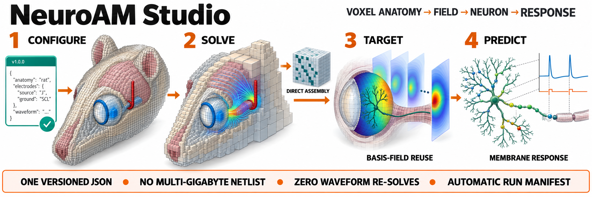
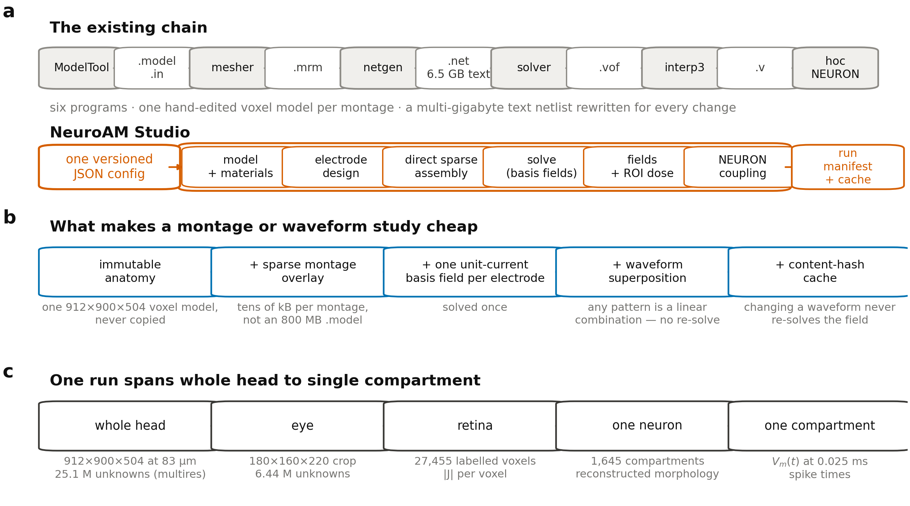

# NeuroAM Studio

**A reproducible, multiscale workflow for voxel bioelectric-field modelling
and compartment-level neural simulation.**



*One versioned configuration connects anatomy, electrode placement, direct
sparse field solution, reusable basis fields, neuronal coupling, and recorded
outputs.*

NeuroAM Studio implements the Admittance Method (AM) on voxel anatomy and
couples extracellular potentials to multicompartment models in
[NEURON](https://neuron.yale.edu/neuron/). It supports both new,
configuration-driven studies and established AM datasets through compatible
readers and writers for the existing model, mesh, field, and coupling formats.

## What you can do

- Assemble uniform or multiresolution AM systems directly as SciPy sparse
  matrices, without generating a multi-gigabyte text netlist.
- Define electrodes in millimetres and register them in anatomical coordinate
  frames, with connectivity and contact-quality checks before solving.
- Solve unit-current basis fields once and reuse them across waveforms and
  current-steering patterns.
- Sample extracellular potential at neuronal compartments, generate legacy
  coupling files, or drive NEURON directly from Python.
- Record reproducible runs with versioned JSON configurations, content hashes,
  solver diagnostics, regional field metrics, and output manifests.
- Create static figures, interactive anatomy views, and self-contained 3D
  field-and-neuron visualizations.

## Start here

Install the core package and run the small analytic example:

```bash
pip install -e .
python examples/01_point_source_validation.py
```

Then follow [Getting started](GETTING_STARTED.md) for installation options,
the configuration workflow, and a first end-to-end run. See
[Architecture](ARCHITECTURE.md) for the system model and
[Validation](VALIDATION.md) for the evidence supporting numerical and
software correctness.

## Workflow and software organization



The architecture diagram complements the workflow illustration above with the
software boundaries and reuse model. Field solution is the expensive stage;
sparse electrode overlays, unit-current basis fields, and content-addressed
caching allow downstream analyses to reuse validated results.

```{toctree}
:maxdepth: 2
:caption: User guide

GETTING_STARTED
ARCHITECTURE
DESIGN
ELECTRODES
```

```{toctree}
:maxdepth: 1
:caption: Reference

FORMATS
LIMITATIONS
VALIDATION
```

```{toctree}
:maxdepth: 2
:caption: API reference

api/index
```

## Documentation status

These pages describe NeuroAM Studio 0.4.0. Quantitative results are reported
with their model, numerical convention, and validation scope. Exploratory
research notes, publication plans, and superseded reports are intentionally
not included in the public documentation build.
